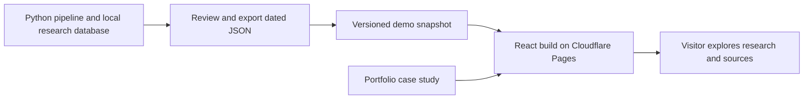

# finAlyse: fintech PM portfolio demo review

Reviewed September 15, 2026 against local/public commit `7281f8c`.
Target: Product Manager applications at fintech companies.

## Recommendation

Keep the existing portfolio URL as a product case study. Link it to a separate,
no-login React demo at a proposed `finalyse.ericcosta.ca` subdomain. Deploy the
demo to Cloudflare Pages with versioned JSON exported from reviewed research
output. Keep Python ingestion and model fitting outside the visitor request path.

This preserves meaningful interactions—filtering disclosures, opening ticker
analysis, inspecting sources and uncertainty—without making a hiring manager
wait for market-data providers, model fitting, or a sleeping backend.

The strongest positioning is:

> finAlyse — an explainable equity-research prototype that brings public
> disclosures, market context, and model limitations into one research workflow.

Present the user segment and value proposition as hypotheses until supported by
actual user research. The immediate portfolio objective is to demonstrate clear
product scope, useful interaction design, evidence-based prioritization, and
responsible treatment of financial information.

## 1. What the project already demonstrates

- An end-to-end implementation: external data clients, normalized persistence,
  scoring and analysis, FastAPI, React, scheduled jobs, and alert integrations.
- Substantial research outputs: simulations, volatility, regimes, factor
  exposure, tail risk, options, and portfolio analysis.
- Good beginnings of operational controls: configurable CORS, admin-gated
  pipeline/training mutations, rate limiting, input validation, CSV protection,
  and optional error reporting.
- Unusually useful portfolio material in the model-status report: explicit
  component availability, sample sizes, baselines, and acceptance gates.

The saved June 22 report contains 202 events and 189 scored events. It reports
3/7 validation gates passing, an untrained XGBoost model, and empty event-study,
Bayesian-decay, and news-sentiment tables. Those are dated research findings,
not evidence of a fully validated live stock-picking product.

Evidence: [saved report](/Users/eric/financial-planner/reports/model_status_report.json:2),
[API controls](/Users/eric/financial-planner/src/api/api.py:62).

## 2. Current public presentation

The live page has a coherent visual style, but the product story and functional
handoff need work:

| Observation | Recommended change |
| --- | --- |
| “Start Analyzing” opens GitHub. | Make the primary CTA “Try the demo”; keep GitHub secondary. |
| “Live Signal,” “Live Analysis,” a 98/100 NVDA score, 87.4% simulated win probability, 68.4% win rate, and 1.85 Sharpe appear without visible provenance. | Remove, substantiate, or clearly label each as illustrative. Do not replace them with another attractive unvalidated return number. |
| “Institutional grade” and “v2.0 Beta Now Available” imply a more established product than the repository establishes. | Use “interactive research prototype” and describe precisely what works. |
| “View Extended Macro” and “Run Backtest” produced no meaningful visible change in this review. | Implement the interaction or remove the control. |
| The headline promises investment planning and portfolio growth tracking. | Focus the promise on interpreting disclosures and evaluating research evidence. |
| The page emphasizes model names and feature breadth. | Explain the intended user, their task, the chosen MVP, tradeoffs, and lessons. |
| Names differ across surfaces: finAlyse, Financial Market Analyzer, Smart Money Follows, financial-planner. | Use finAlyse as the public name with a consistent descriptive subtitle; the repository slug can stay. |

The live page's numbers were not substantiated by the reviewed repository. This
does not establish how the separate website generates them. In a copied local
database, `/api/analysis/NVDA` returned no populated analysis fields; choose demo
tickers based on actual coverage instead of assuming the homepage examples exist.

## 3. The demo experience to build

Aim for a complete three-minute journey:

1. **Understand the task.** “Explore how public trading disclosures can inform
   equity research.” Display “Historical demo — data as of [date]” prominently.
2. **Explore a small research universe.** Show 5–10 tickers selected for data
   coverage, including a mixed or inconclusive case. Explain selection criteria;
   do not imply the selection is representative investment performance.
3. **Inspect one disclosure.** Show actor, transaction direction, trade date,
   disclosure date, source link, and time available to a researcher.
4. **Understand supporting evidence.** Explain price history, volatility,
   market regime, and model coverage in plain language. Put technical detail
   behind expandable explanations.
5. **See the limits.** Distinguish observed facts, simulated estimates, and
   experimental scores. Missing data should say “unavailable in this snapshot.”
6. **Return to the case study.** Offer the product decisions, methodology, code,
   and a short walkthrough video.

For the first release, omit admin pipeline/update controls and arbitrary live
backtests. Use “View research evaluation” for any precomputed historical result,
and show unresolved methodological caveats alongside it. Rename ensemble
“confidence” to “model coverage”: the implementation calculates available model
weight, not the probability that a prediction is correct.

Evidence: [confidence calculation](/Users/eric/financial-planner/src/analysis/ensemble_scoring.py:178),
[current UI label](/Users/eric/financial-planner/dashboard/src/components/EnsembleScore.tsx:65).

## 4. Deployment architecture and settings

### Initial deployment

| Setting | Proposed value |
| --- | --- |
| Host | Cloudflare Pages |
| Repository | `ericnc09/financial-planner` |
| Root directory | `dashboard` |
| Build command | `npm run build` |
| Output directory | `dist` |
| Production branch | `main`, after demo changes are merged |
| Domain | `finalyse.ericcosta.ca` (proposed; not created) |
| Data | Public JSON under `dashboard/public/demo/` |
| Demo flag | Add and implement `VITE_DEMO_MODE=true` |
| Refresh policy | Manually reviewed snapshot releases initially |

These are target settings, not enough to deploy the existing application as-is.
The demo data adapter and exported JSON do not currently exist. The Vite flag
must be implemented before setting it has any effect.

Cloudflare documents Git-based Vite builds, static output, and preview
deployments. Its purely static Pages projects have free static requests, with
plan/build limits. Expected incremental static hosting cost for this demo is
$0 within the free plan. Sources: [Vite deployment guide](https://developers.cloudflare.com/pages/framework-guides/deploy-a-vite3-project/),
[static request behavior](https://developers.cloudflare.com/pages/functions/routing/),
[Pages limits](https://developers.cloudflare.com/pages/platform/limits/).

Add the subdomain to the Pages project first, then configure the indicated DNS
record. This does not require replacing the current portfolio host. Source:
[custom domain setup](https://developers.cloudflare.com/pages/configuration/custom-domains/).

### Snapshot implementation

- Add an exporter that selects intended public fields and packages the chosen
  disclosures, ticker analyses, price series, macro context, and coverage report.
- Include `snapshot_id`, `schema_version`, `as_of`, `generated_at`, code commit,
  source timestamps, provenance, and availability metadata. A single export
  timestamp must not imply every underlying input is equally fresh.
- Make date filters relative to the snapshot's `as_of`, retaining original dates.
  Never move old events forward to make them appear current.
- Route all UI reads through one data interface with live and snapshot adapters.
  Several components fetch `/api` directly, so changing only `client.ts` will
  leave parts of the demo broken. Include exports and price charts in this work.
- Keep filtering/sorting/selection in the browser; bound the interface to bundled
  tickers and data. Show an explicit unavailable state for unsupported choices.
- Version assets together. A refresh must validate the candidate before replacing
  the existing working snapshot. Keep rollback possible.
- Add checks for JSON schema, referential integrity, finite chart values, expected
  coverage, and the core visitor journey. An experimental model failing a research
  gate should be disclosed; it need not block a research demo when the claim is
  accurately scoped.

Evidence: [API client](/Users/eric/financial-planner/dashboard/src/api/client.ts:3),
[direct top-pick fetch](/Users/eric/financial-planner/dashboard/src/components/TopPickCard.tsx:32),
[direct performance fetch](/Users/eric/financial-planner/dashboard/src/components/PerformancePanel.tsx:29),
[development proxy](/Users/eric/financial-planner/dashboard/vite.config.ts:6).

### When a live backend becomes worthwhile

Add it when actual users need fresh research or custom server-side analysis.
Use a separately hosted FastAPI service, shared persistent database, and scheduled
worker, while retaining a labeled snapshot fallback for portfolio visitors.

The existing deployment roadmap requires revision. Postgres needs a driver,
migrations, conversion of SQLite-specific reporting, a shared pipeline URL, and
backup URL handling. “Mostly change the database URL” understates this work.
Do not size the ML-heavy runtime at 256 MB without measurement.

A sleeping free API is a poor first-click experience: Render documents a
15-minute idle shutdown and roughly one-minute startup. Its free filesystem is
ephemeral and free Postgres expires after 30 days. If choosing a live service,
budget for persistent storage and suitable paid compute after profiling. Source:
[Render free-service limitations](https://render.com/docs/free).

## 5. Technical findings and priority

### Address for the demo or before refreshing its data

1. **Historical data empties the default UI.** An isolated API check on a database
   copy returned zero dashboard signals, no top pick, and zero sectors on
   September 15. Current filters use today's UTC date. Implement explicit
   snapshot-relative queries; simply hosting the June database will look empty.
   [signal cutoff](/Users/eric/financial-planner/src/api/api.py:457).

2. **Portfolio endpoint is unreachable through its intended route.**
   `/api/analysis/mean-variance` returns 422, “Invalid ticker symbol,” because the
   earlier dynamic ticker route captures it. Register static routes first and
   add a positive endpoint test.
   [dynamic route](/Users/eric/financial-planner/src/api/api.py:726),
   [portfolio route](/Users/eric/financial-planner/src/api/api.py:1135).

3. **A duplicate event can discard new events in the same batch.** The ingestion
   loop rolls back the whole transaction on a duplicate while retaining earlier
   IDs in its returned list. Reproduced in isolated SQLite: `[NEW, existing OLD]`
   reports NEW inserted, but only OLD remains. Use conflict-safe inserts or
   savepoints and a mixed new/duplicate regression test before refreshing data.
   [event persistence](/Users/eric/financial-planner/src/pipeline/orchestrator.py:294).

4. **Errors and controls need visitor-facing behavior.** Cards silently disappear
   on errors; initial API failure instructs visitors to run Uvicorn. The performance
   update button sends no admin token and ignores the result. Remove admin controls
   from the demo and provide clear loading, missing-data, and error states.
   [App](/Users/eric/financial-planner/dashboard/src/App.tsx:63),
   [performance update](/Users/eric/financial-planner/dashboard/src/components/PerformancePanel.tsx:55).

### Resolve before publishing investment-performance claims

- Historical evaluation joins old returns with each event's latest ensemble
  score, without requiring that score to exist at entry time. ML training also
  assembles latest ticker model outputs for historical events. This permits
  future information to influence retrospective evaluation.
  [evaluation query](/Users/eric/financial-planner/scripts/model_status_report.py:228).
- Missing Yahoo data is treated as delisting/bankruptcy, generating extreme
  returns. Provider failures need an unavailable/retry state; verified delistings
  need separate handling.
  [performance tracking](/Users/eric/financial-planner/src/tracking/performance.py:60).
- Backtest drawdown is computed from cumulatively added returns in asynchronous
  completion order. It is not a chronological portfolio equity drawdown.
  [backtester](/Users/eric/financial-planner/src/backtesting/backtester.py:207).
- XGBoost preprocessing fits imputation before cross-validation and does not
  purge overlapping 20-day labels. The current artifact is untrained; retain
  that label until corrected and evaluated.
  [classifier](/Users/eric/financial-planner/src/analysis/xgboost_classifier.py:131).
- Entry/horizon conventions differ across tracking, backtesting, and event
  studies. Define what a user could have known and when they could act before
  claiming followable performance.

These findings make the model-governance work useful case-study material. The
reporting framework itself still needs validation; 3/7 passing gates is not a
certificate of investment performance.

### Resolve before an unattended live deployment

- GitHub Actions hardcodes a runner-local SQLite database and saves it to cache.
  There is no publication step or shared database feeding the website.
  [workflow](/Users/eric/financial-planner/.github/workflows/pipeline.yml:60).
- Price requests call Yahoo on a cache miss. Public backtest endpoints perform
  potentially expensive upstream work despite rate limits. Cache/precompute
  demo outputs and use bounded jobs for future custom analysis.
  [API endpoints](/Users/eric/financial-planner/src/api/api.py:1383).
- Postgres schema evolution, SQLite-only report scripts, backup configuration,
  and database-failure health status need explicit deployment tests.
  [database upgrades](/Users/eric/financial-planner/src/models/database.py:551).

## 6. The case study hiring teams should read

Suggested outline, in reading order:

1. **Problem and audience:** one clearly defined research task; separate observed
   evidence from assumptions about the user.
2. **My role:** what Eric owned in discovery, scope, UX, technical decisions, and
   evaluation. Describe collaborators and AI assistance accurately.
3. **MVP decision:** why this workflow was chosen and what was deferred.
4. **Try the demo:** a working primary CTA and a 60–90 second walkthrough.
5. **Three consequential decisions:** source traceability, experimental-score
   labeling, and a dependable dated demo. Describe them as proposed decisions
   until implemented.
6. **Results and learning:** distinguish delivered functionality, research
   findings, usability observations, and proposed success metrics.
7. **Next experiment:** the smallest test that would change the next priority.

Conduct 5–8 task-based sessions with people matching the proposed audience.
Give them the same task using current tools and then the prototype. Measure task
completion, time to locate evidence, and whether they can explain the limitation
of a score. Report actual counts and observations; a small study is directional
evidence, not proof of market demand.

Proposed product measures: successful research-task completion, time to a sourced
explanation, and comprehension of uncertainty. Proposed demo funnel: case-study
visit → demo opened → disclosure inspected → evidence viewed. Reliability and
misinterpretation are guardrails. Keep model return metrics separate from product
usability metrics. Label all unmeasured targets as proposed.

For GitHub, add the live demo and case-study links near the top, a screenshot or
short recording, a one-command demo start, and a concise “implemented / available
in this snapshot / experimental” summary. Keep the detailed model audit
accessible, while giving visitors a clear introduction before the diagnostic
tables. Set the repository About URL to the demo once it exists.

## 7. Suggested release sequence

| Stage | Deliverable | Acceptance criterion |
| --- | --- | --- |
| 1. Honest scope | Consistent naming, revised claims, selected research task | Every displayed metric has a definition and provenance or is explicitly illustrative. |
| 2. Reliable demo | Reviewed snapshot, data adapter, three-minute journey | No visitor action requires an admin token or a live provider; dates and missing data are explicit. |
| 3. Public deployment | Pages preview, custom domain, case-study CTA | Core journey works on desktop/mobile and with keyboard; refresh/deep links work; failed updates preserve the previous version. |
| 4. PM evidence | Short video, usability sessions, decision log | Case study distinguishes observations, hypotheses, and next experiments. |
| Later | Shared live database, jobs, validated performance | Only pursue when a user need justifies the additional work. |

A reasonable planning estimate is 3–5 focused development days for a narrow
snapshot demo and portfolio packaging, followed by time for user sessions.
This is an estimate, not a commitment; correcting all analytical methods and
building a live platform is a separate scope.

## 8. Verification and review boundaries

- Python test suite: **11 passed** against an isolated temporary SQLite database.
- React/TypeScript production build: **passed** with installed dependencies.
- Read-only API checks used a temporary copy of the local database: health 200;
  dashboard 200 with zero signals; top pick null; sectors empty; mean-variance
  422; NVDA analysis 200 with no populated analysis fields.
- Inspected the live case-study page and public GitHub repository. Public HEAD
  matched local `7281f8c` at review time.
- Reviewed frontend, backend, clients/pipeline, persistence, analysis/evaluation,
  tests, workflows, reports, and deployment documentation. Most substantive
  tests are API security and schema/model-status checks; passing them does not
  establish comprehensive analytical correctness.
- No fresh provider ingestion, notifications, model training, deployment, or
  external writes were performed. No production source code was changed.
- This review document is the only added project file. Existing untracked
  images and Substack files were left untouched.
